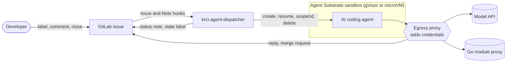
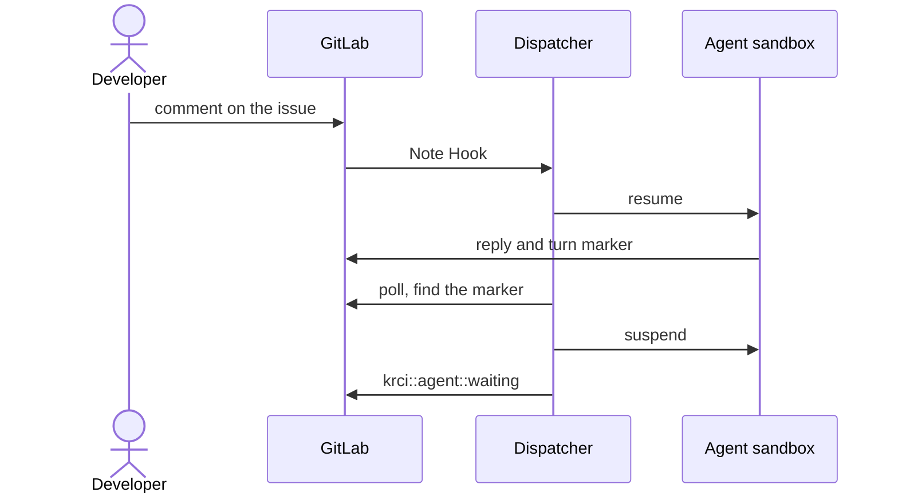

# krci-agent-dispatcher

Run AI coding agents on real work without giving them your cluster or your secrets.

krci-agent-dispatcher is the KubeRocketCI orchestrator for isolated AI coding agents. Each task gets its own Agent Substrate sandbox (gVisor or microVM). The agent writes code, builds and tests it in the sandbox, and sends the result back as a merge request for human review.

Today the task is a GitLab issue. The orchestrator is built for more triggers and agents.

## Why

- **Isolated:** one sandbox per task, separate from your cluster and from other tasks.
- **No secrets inside:** the agent holds placeholders only. The egress proxy adds the real credentials on the way out.
- **Closed network:** only the model API, your GitLab and the Go module proxy are reachable. All other hosts are denied.
- **Human in the loop:** the agent opens a merge request. A person reviews and merges it.

## How it works



One turn:



## Use it

| You do | The agent |
|---|---|
| Add the `krci-agent` label to an open issue (trigger role or higher) | starts and takes its first turn |
| Comment (trigger role or higher) | takes the next turn |
| Close the issue, or remove the label | stops; its sandbox is deleted |

The state label shows where the agent is: `krci::agent::working`, `krci::agent::waiting`, `krci::agent::done`, `krci::agent::error`. The status note on the issue shows the details.

The trigger role is the lowest GitLab project role whose users can start the agent and write trigger comments. Set it with `TRIGGER_MIN_ROLE` (chart value `config.triggerMinRole`):

| Value | Who can trigger the agent |
|---|---|
| `developer` (default) | Developers, Maintainers, Owners |
| `maintainer` | Maintainers, Owners |
| `owner` | Owners |

Values are case-insensitive. `guest`, `reporter` and any other value stop the dispatcher at start: the agent pushes with the bot user's token, so only users who can push trigger it.

## Limitations

- Confidential issues are not supported. The hook does not send their events, and the dispatcher ignores them. Do not enable the confidential events on the hook by hand.

## Build

```
make lint test build
docker build -t <registry>/krci-agent-dispatcher:<tag> .
```

## Contribute

Claude Code plugins used in this repo:

```
claude plugin marketplace add KubeRocketCI/claude-plugins
claude plugin install krci-general
claude plugin marketplace add mattpocock/skills
claude plugin install mattpocock-skills
```

Commit messages: `/krci-general:commit`. Conventions: `CLAUDE.md`. Issue workflow: `docs/agents/`.

## Deploy

```
helm upgrade --install krci-agent-dispatcher deploy-templates -n <namespace> -f <values.yaml>
hack/register-hook.sh add <project-path> https://<ingress-host>/hook
```

Chart values: `deploy-templates/README.md`. Configuration (env): `internal/config/config.go`.

## Documentation

| Document | Content |
|---|---|
| [GLOSSARY.md](GLOSSARY.md) | Terms |
| [docs/adr/](docs/adr/) | Decisions |
| [docs/agent-image-contract.md](docs/agent-image-contract.md) | What the agent image (`agentImage`) receives and what the dispatcher reads back |
