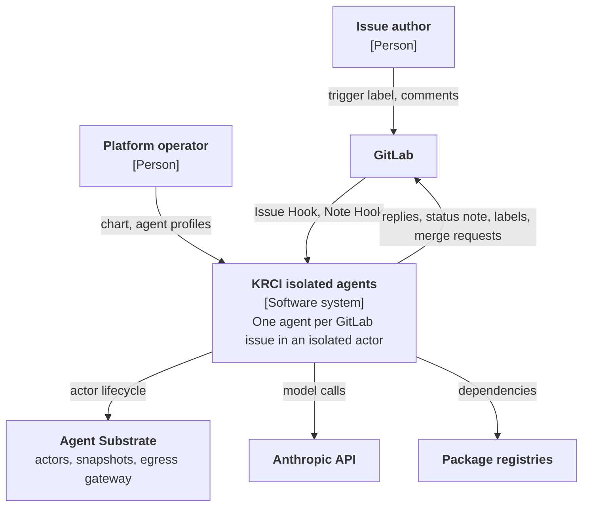
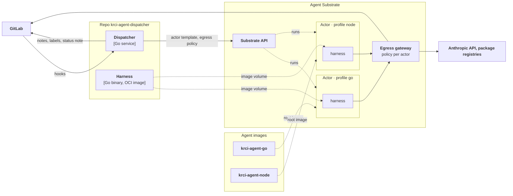
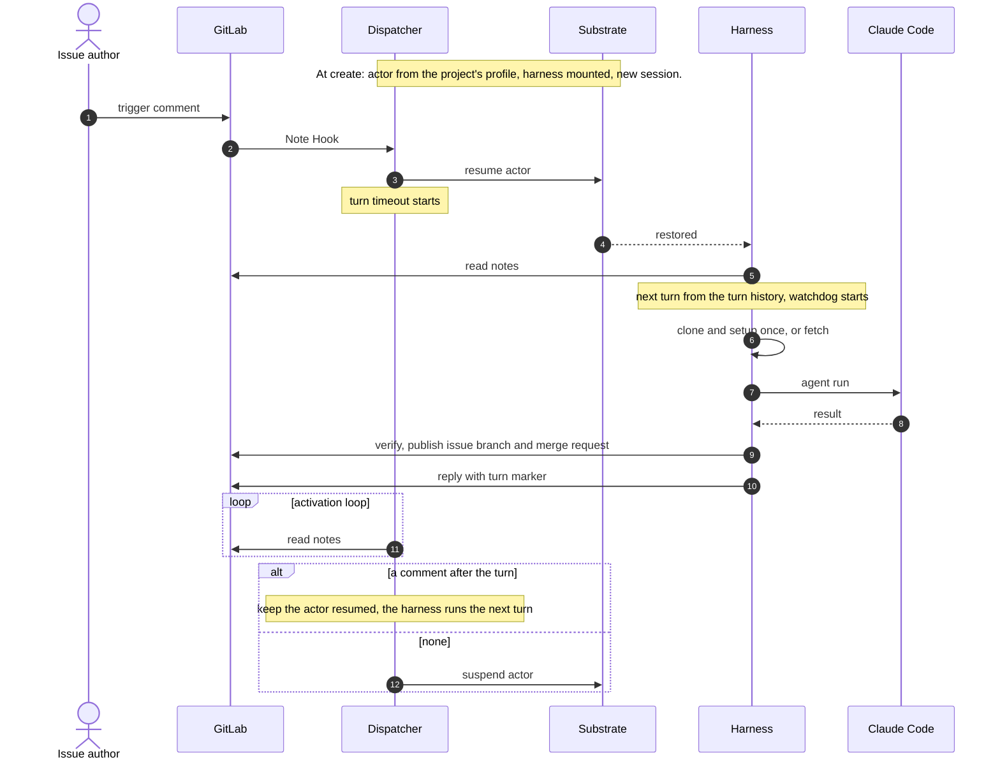

# Agent harness

How the dispatcher, the harness and agent images work together. Target design, contract version 1. Terms: `GLOSSARY.md`. Decisions: ADR 0003, 0004, 0006, 0007, 0008.

## Parts

| Part | Role | Owner |
|---|---|---|
| Dispatcher | GitLab events → one actor per issue → resume, suspend, stop | this repo |
| Harness | The agent loop in every actor: handshake, turns, replies, publish | this repo |
| Agent image | Tools of one kind of agent and its profile file | the agent's owner |
| Agent profile | Image, egress, env (dispatcher config); setup, verify, prompt (agent image) | the operator and the agent's owner |

Rules:

- The turn protocol is implemented once, in this repo; the dispatcher and the harness share it.
- Needs from outside the sandbox (image, egress, env) are dispatcher config. Steps inside the sandbox (setup, verify, prompt) belong to the agent image.
- A sandbox need is met on the sandbox side. Dispatcher logic does not change for one kind of agent.
- The dispatcher and the harness talk only through issue notes: comments in, one reply per turn out.

## Context



## Containers

Every actor runs the same harness, mounted by the dispatcher, on the agent image of the project's profile.



## One turn



## Dispatcher → harness

- The actor runs the agent image of the project's profile, with the harness mounted read-only at `/opt/krci-agent` and `/opt/krci-agent/krci-agent-harness` as the command. The OCI image the harness ships in holds the binary at `/krci-agent-harness`.
- The actor template sets the issue, the bot user, a new session, the contract version, the turn timeout, agent steps, the model and the profile's env.
- Secrets never enter the actor. The egress gateway adds the GitLab and Anthropic credentials on the way out.
- Egress: Anthropic, the GitLab host and the profile's hosts. Nothing else.

## Harness

- Handshake at start: env, contract version, profile file, watchdog limit. On failure it logs one line and exits 78; the dispatcher records `actor crashed`.
- Turn loop: poll the notes, take the next turn from the turn history, run it, reply. Every turn ends in a reply, also when it fails.
- Watchdog: `turn timeout − poll interval − 60 s` per turn; it covers clone or fetch, setup, the agent run, verify and publish. A cut turn replies with exit 124.
- Publish: the issue branch `agent/issue-<iid>` and its merge request to the project's default branch, only after `verify` passes.
- No turn counter. A reply not yet posted is retried, once per session and turn number.

## Turn marker

The last line of every reply:

```text
<!-- krci-agent-turn s=<session> n=<n> exit=<rc> last=<note-id> -->
```

`s` session, `n` turn number in the session, `exit` result of the turn, `last` highest comment note id the turn covered.

- Turn history: the markers of the current session and the comments. A session without a marker starts turn 1 at once. A later turn starts only on a comment after `last`.
- The turn limit counts `n` of the current session.
- The dispatcher reads markers only from the bot user's notes.

## Agent image

An agent image provides:

- `claude`, `git` and `sh` on `PATH`;
- user uid 1000 with writable `HOME` and `/work`;
- `/opt/krci-agent` free for the harness;
- optional `/etc/krci-agent/profile.yaml`: `setup` (once after clone), `verify` (before publish), `prompt` (added to the system prompt).

`krci-agent-harness selftest` checks an image against this list.

## Agent profile

Dispatcher config, one entry per kind of agent:

| Value | Meaning |
|---|---|
| `agents.<name>.image` | agent image, pinned by digest |
| `agents.<name>.egress` | extra hosts the agent may reach |
| `agents.<name>.env` | extra plain env, no secrets |
| `projects` | project path → profile |
| `defaultAgent` | profile of any other project |

A new stack is a new agent image plus a profile entry.

## The harness and the agent must not

- Post a turn marker before the turn's work is done.
- Post, edit or delete the status note, or post the dispatcher's own markers.
- Close the issue, remove the trigger label or change a state label.
- Open a merge request from a branch other than the issue branch.
- Depend on a host outside the egress policy.
