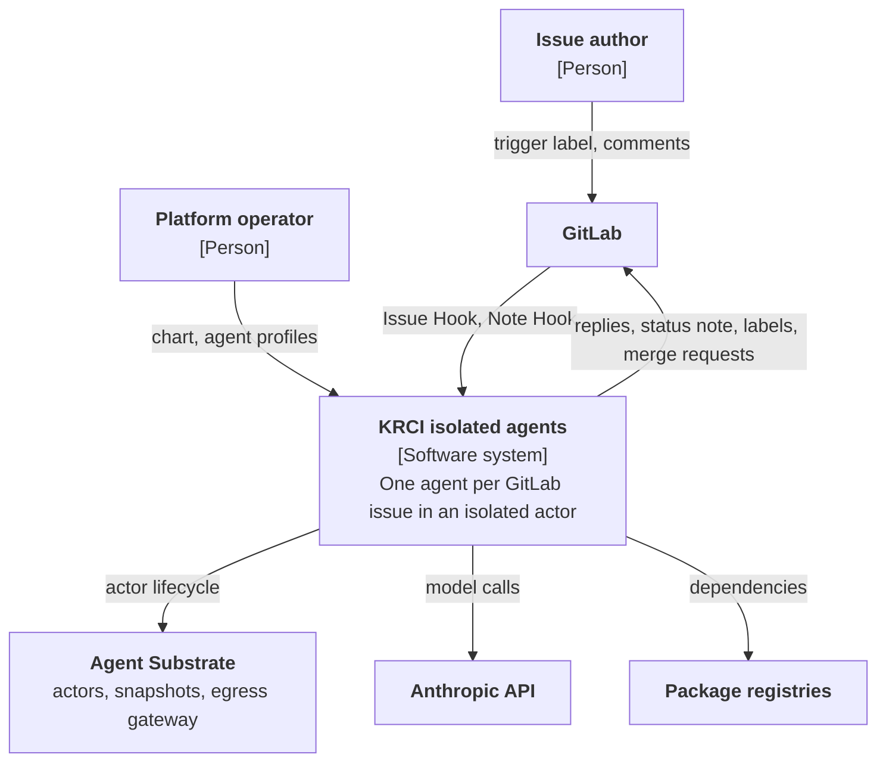
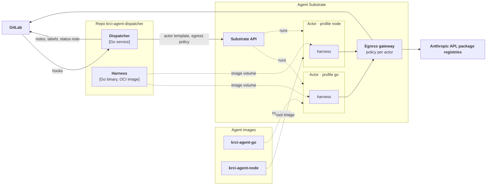
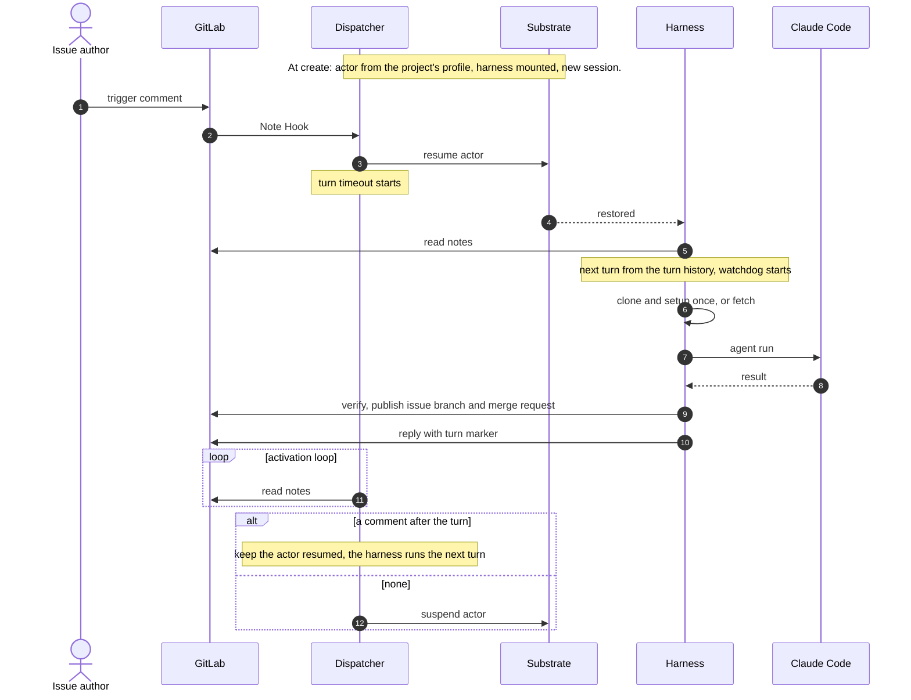

# Agent harness

How the dispatcher, the harness and agent images work together. Target design, contract version 1. Terms: `GLOSSARY.md`. Decisions: ADR 0003, 0004, 0006, 0007, 0008.

## Parts

| Part | Role | Owner |
|---|---|---|
| Dispatcher | GitLab events → one actor per issue → resume, suspend, stop | this repo |
| Harness | The agent loop in every actor: handshake, turns, replies, publish | this repo |
| Agent image | Tools of one kind of agent and its profile file | the agent's owner |
| Agent profile | Image, egress, env (dispatcher config); setup, verify, prompt (agent image) | the operator and the agent's owner |

Rules:

- The turn protocol is implemented once, in this repo; the dispatcher and the harness share it.
- Needs from outside the sandbox (image, egress, env) are dispatcher config. Steps inside the sandbox (setup, verify, prompt) belong to the agent image.
- A sandbox need is met on the sandbox side. Dispatcher logic does not change for one kind of agent.
- The dispatcher and the harness talk only through issue notes: comments in, one reply per turn out.

## Context



## Containers

Every actor runs the same harness, mounted by the dispatcher, on the agent image of the project's profile.



## One turn



## Dispatcher → harness

- The actor runs the agent image of the project's profile, with the harness mounted read-only at `/opt/krci-agent` and `/opt/krci-agent/krci-agent-harness` as the command. The harness image holds the binary at `/krci-agent-harness`.
- The actor template sets the issue, the bot user, a new session, the contract version, the turn timeout, the harness poll interval, the turn limit, agent steps, the model, `HOME=/home/agent`, `AGENT_PROFILE` and the profile's env.
- Dispatcher config: `HARNESS_IMAGE` (required, pinned by digest), `PROFILES_FILE` (default `/etc/krci-agent-dispatcher/profiles.yaml`), `AGENT_STEPS` (default 40), `AGENT_MODEL` (default `claude-haiku-5-5`), `HARNESS_POLL_INTERVAL` (default 15 s). `TURN_TIMEOUT` and `HARNESS_POLL_INTERVAL` are whole seconds; the dispatcher refuses to start when `TURN_TIMEOUT` is below `HARNESS_POLL_INTERVAL + 120 s`, so every rendered template passes the handshake.
- A start on a done issue whose actor is transitional, by an author who can trigger, is rechecked, then recorded as error `actor busy`; a suspended, crashed or partial actor is deleted and recreated with a new session.
- Secrets never enter the actor. The egress gateway adds the GitLab and Anthropic credentials on the way out.
- Egress: Anthropic, the GitLab host and the profile's hosts. Nothing else.

## Harness

- Handshake at start: env, contract version, watchdog limit, then the profile file. On failure it logs one line and exits 78; the dispatcher records `actor crashed`.
- Turn loop: poll the notes, take the next turn from the turn history, run it, reply. Every turn ends in a reply, also when it fails.
- Watchdog: `turn timeout − poll interval − 60 s` per turn; it covers clone or fetch, setup, the agent run, verify and publish. A cut turn replies with exit 124.
- Publish: the issue branch `agent/issue-<iid>` and its merge request to the project's default branch, only after `verify` passes. The push is never forced. The merge request is `Draft: Resolve "<issue title>"` with `Closes #<iid>`; an issue title that does not fit GitLab's 255 characters is cut and ends with `…`. An open merge request of the issue branch is left as it is.
- New-commits check, after the agent run: new commits are commits on the issue branch that no remote branch has. It fails on another branch and on changed tracked files; untracked files that `.gitignore` does not exclude fail it only when there are new commits, and the logged error names the first 5 paths.
- Without new commits a turn skips verify and push: an answer without code is a done turn, exit 0. A push leaves the merge request pending in the harness state until it is opened or found open, in that turn or a later one: a merge request that failed after a push opens later, and a merge request the person closed stays closed until the next push. The default branch is read only for a pending merge request.
- No turn counter. A reply not yet posted is retried, once per session and turn number.

### `krci-agent-harness run`

`run` takes no arguments; no argument is usage, exit 64. It reads the env contract and the profile file, then runs the turn loop until SIGTERM or SIGINT, exit 0.

Logs are JSON lines on stderr; the output of git, setup and verify and the stderr of Claude Code are logged line by line, at most 64 KiB per record. Each turn logs `Turn started` with `turn`. After prepare, `Agent run started` with `turn` and `new_session` (`true`: the agent run starts the session, `--session-id`; `false`: it continues it, `--resume`). At the end, `Turn done` with `turn` for exit 0, else `Turn failed`. A turn cut by the harness stop logs no end line. A failed turn is logged with its phase, exit code and error; the reply names only the phase and the exit code. Exit codes: 0 terminated, 78 handshake failure, 70 GitLab client or agent not built.

Workspace: the checkout is `/work/<last element of PROJECT_PATH>`, cloned from `<GITLAB_URL>/<PROJECT_PATH>.git`. A clone checks out the remote issue branch when it exists, else creates it from the default branch, then runs `setup`. Before a fetch the checkout is tidied: an unfinished rebase, merge, cherry-pick or revert is aborted, changed tracked files go into a stash entry, and a checkout on another branch or a detached HEAD is switched back to the issue branch. Untracked files stay. A fetch brings the issue branch up to the remote one: fast-forward, else a rebase of the local commits. A rebase that conflicts is aborted; the local commits are kept on the local branch `agent/issue-<iid>-unpushed-<n>`, and the issue branch is reset to the remote one. The prompt names each aborted operation, the stash entry's commit id, the set-aside branch and, after the fetch, the untracked paths that `.gitignore` does not exclude, an untracked directory as one path, at most 5 by name. Every git, setup and verify process runs in its own process group: TERM when the watchdog context ends, KILL 5 s later; processes left in the group after the command exits are killed.

Git auth: only the harness's own git commands (clone, fetch, push) carry `http.<GITLAB_URL>/.extraHeader: Authorization: Basic placeholder`; the actor env does not, so `git` run by the agent or by setup and verify gets 401 from GitLab.

Agent run: `claude -p --output-format stream-json --verbose --max-turns <AGENT_STEPS> --model <ANTHROPIC_MODEL> --permission-mode bypassPermissions --disallowedTools "Bash(git push:*)" --append-system-prompt <system prompt>`, in the checkout, the prompt on stdin. The system prompt is the harness rules, embedded in the binary, then the profile's `prompt`. The rules name the untracked-files rule of the new-commits check; that commits on the remote issue branch are not amended, rebased or squashed, as the push is never forced, and that the default branch is taken in with a merge; and the profile's `verify` command when set. The result text is the last `result` event of the stream. The conversation id is a UUID v5 of `SESSION_ID`: a run uses `--session-id` until a stream of the session had its `init` event, recorded in `$HOME/.krci-agent/conversation`, then `--resume`. A failing `--resume` fails the turn at `agent`; it does not start a new conversation.

GitLab calls send the constant `PRIVATE-TOKEN: placeholder`; the egress gateway replaces it with the bot user's token.

State directory: `$HOME/.krci-agent/state.json`, written atomically. `HOME` unset or empty is a handshake failure, exit 78.

### Env contract

| Env | Rule |
|---|---|
| `GITLAB_URL` | `https://<host>[:<port>][/<path>]`, no user info, query or fragment |
| `PROJECT_ID` | integer > 0 |
| `ISSUE_IID` | integer > 0 |
| `PROJECT_PATH` | non-empty |
| `BOT_USERNAME` | non-empty |
| `SESSION_ID` | `[0-9A-Za-z-]+` |
| `AGENT_CONTRACT_VERSION` | `1` |
| `TURN_TIMEOUT_SECONDS` | integer > 0, at most 9223372036 |
| `POLL_SECONDS` | integer > 0, at most 9223372036 |
| `TURN_LIMIT` | integer > 0 |
| `AGENT_STEPS` | integer > 0 |
| `ANTHROPIC_MODEL` | non-empty |

Watchdog limit `W = TURN_TIMEOUT_SECONDS − POLL_SECONDS − 60 s`; the handshake requires `W ≥ 60 s`.

A handshake failure logs one line that names the item and the rule, never the value, and exits 78.

### Poll

- One poll per `POLL_SECONDS`. The first read, and every read while a reply is pending, is a full read; later polls refresh the last read. A refreshed result with a turn that can start is confirmed with a full read before the harness acts: a refresh keeps notes deleted since the last read.
- A reply not yet posted (pending reply) comes first. It is held in memory and in the state file. It is dropped when the turn history holds a marker of its session with the same turn number, and the same poll goes on to the next turn; otherwise it is posted again and the poll ends. No new turn starts while a reply is pending.
- The next turn starts when the turn history has a comment above the last marker's `last=`, or no marker, and the last marker's turn number is below `TURN_LIMIT`.
- The watchdog deadline is `W` after the start of the poll. It covers workspace preparation, the agent run, the new-commits check, verify, the push, the default branch read and the merge request.
- A call cut by the deadline gives exit 124. A cancelled harness posts no reply.
- Prompt of a new conversation (no agent run of the session started one): the issue title and description, then every comment up to the turn's last. A resumed conversation: the comments no turn covered. Both end with what the fetch moved out of the way and the untracked paths, when any.
- Reply body: the agent text, then `Turn failed at <phase>, exit <rc>.` when `exit` is not 0, or `Turn done.` when the text is empty and `exit` is 0, then the marker.
- A reply body is at most 50,000 characters; longer text is cut and ends with `[Reply truncated.]` before the marker.
- The reply is saved, then posted with a context of its own, bounded to 30 s, not the watchdog context. A successful post clears the saved reply.

### Failure handling by phase

| Phase | Failure | Result |
|---|---|---|
| State read | read error | no work in this poll |
| State read | corrupt file | logged once; read as empty; the next save replaces it |
| Notes read | any error | no work; retry on the next poll |
| Pending reply | post fails | stays pending; retry on the next poll |
| Turn work | prepare, agent, new-commits check, verify, push, default branch, merge request | the turn ends in this poll with a failed reply; never retried as work; a merge request is ensured again on the next turn |
| Reply save | state write fails | logged; no post; the next poll saves again, then posts |
| Reply clear | state write fails | logged; the next poll finds the saved reply, drops it |
| Session-started flag | state write fails | logged; the next turn clones and sets up again |

| Outcome | `exit` |
|---|---|
| Turn completes | 0 |
| Agent run completes with 0, no new commits | 0; verify and push are skipped |
| Agent run completes with a code other than 0 | the agent code; the default branch read, verify and publish are skipped |
| Agent run fails without a code | 1 |
| Prepare, default branch read, new-commits check, verify, push or merge request fails | 1 |
| Watchdog expires | 124 |

Phases named in a failed reply: `prepare`, `agent`, `verify`, `publish`; the default branch read, the new-commits check (another branch, changed tracked files, untracked files with new commits), the push and the merge request are `publish`.

Accepted: a reply held only in memory is lost on a restart, and its turn runs again. A marker deleted by a person after a successful post while the saved reply remains: the saved reply is posted again.

Agent, Workspace, default branch read and merge request calls get the watchdog context. Its deadline comes from `Clock.WithDeadline`. An Agent adapter sends TERM 30 s before the deadline and KILL at it. A call cut at TERM returns an error that wraps `context.DeadlineExceeded`; a call that returns any error after the deadline was cut too. Both give exit 124.

## Turn marker

The last line of every reply:

```text
<!-- krci-agent-turn s=<session> n=<n> exit=<rc> last=<note-id> -->
```

`s` session, `n` turn number in the session, `exit` result of the turn, `last` highest comment note id the turn covered.

- Fixed field order, every field required; `s` is `[0-9A-Za-z-]+`. Per note the last marker counts, then its session is checked.
- Turn history: the markers of the current session and the comments. A session without a marker starts turn 1 at once. A later turn starts only on a comment after `last`.
- Current session: the dispatcher's is the `SESSION_ID` of the actor template while the actor exists, else the `Session` row of the status note; the harness's is its `SESSION_ID`. Recovery rule, dispatcher only: with neither, the session of the newest bot marker. A set session without a marker takes no other session.
- Re-enable cut: the status note records done and the actor's template names another session than the status note's. The re-enable created the actor and its record writes did not land. The done record is no record then, for every request: the issue goes on as after the create. Without a turn marker of the actor's session, the first activation; a partial actor is created again on a start or a recover request; a running actor is continued.
- Any other done issue with an actor (a label-only done, the actor's own session, an actor without a session) is a done set by a person: a running actor is stopped, any other is left as it is.
- Re-enable creates the actor with a new session: turn 1 over every comment, the turn limit counted again. Old notes stay.
- The turn limit counts `n` of the current session.
- The dispatcher reads markers only from the bot user's notes.
- Every `<!-- krci-agent-` in the agent's reply (turn, status, start-refused, stopped markers) is written as `&lt;!-- krci-agent-` and does not parse.

## Agent image

An agent image provides:

- `claude`, `git` and `sh` on `PATH`;
- user uid 1000 with writable `/home/agent` (the `HOME` the actor template sets) and `/work`;
- `/opt/krci-agent` free for the harness;
- optional `/etc/krci-agent/profile.yaml`: `setup` (once after clone), `verify` (before publish), `prompt` (added to the system prompt). `setup` and `verify` are shell commands, run with `sh -c` in the checkout. A field other than these three, or a value that is not a string, fails the handshake.

`krci-agent-harness selftest` checks an image against this list. Its check `profile_valid` fails on a profile file the handshake rejects (unreadable, not YAML, another field, a value that is not a string) and passes without a file; its detail names the file and the rule, never the content. It runs with the binary outside `/opt/krci-agent`, for example in agent image CI:

```bash
docker run --rm -v ./krci-agent-harness:/tmp/krci-agent-harness:ro <agent-image> /tmp/krci-agent-harness selftest
```

## Agent profile

Dispatcher config: the profiles file, raw YAML, `PROFILES_FILE` (default `/etc/krci-agent-dispatcher/profiles.yaml`). The chart embeds `deploy-templates/profiles.yaml` verbatim into a ConfigMap mounted as a directory; `profiles.existingConfigMap` mounts the operator's ConfigMap (key `profiles.yaml`) instead.

```yaml
profiles:
  go:
    image: epamedp/krci-agent-go:0.1.1@sha256:<digest>
    egress: [proxy.golang.org, sum.golang.org, storage.googleapis.com]
    env:
      GOPROXY: https://proxy.golang.org
projects:
  krci/test-go-app: go
defaultProfile: go
```

| Key | Meaning |
|---|---|
| `profiles.<name>.image` | agent image, pinned by digest; required |
| `profiles.<name>.egress` | extra hosts the agent may reach: TLS passthrough on port 443 |
| `profiles.<name>.env` | extra plain env, no secrets; a name the actor template sets is refused |
| `projects` | project path → profile name; matched case-insensitively |
| `defaultProfile` | profile of any other project |

A profile name is `[a-z0-9]([a-z0-9-]*[a-z0-9])?`. An egress host is a DNS name, not the Anthropic or the GitLab host. Env values are taken as written (`3.10` stays `3.10`). A file of another shape, an unknown top-level key, a profile or a project listed twice refuses the file; an entry of another shape or with an unknown key fails only the projects of that profile. A project mapped to an empty profile does not fall back to the default profile.

Profile resolution runs at each actor create: the dispatcher reads the file, takes the project's profile, checks it and renders the actor with it. No cache and no dispatcher restart: a change reaches the next create once the kubelet has synced the ConfigMap. A change applies to new sessions only; an open actor keeps what it was created with (ADR 0008).

A failed profile resolution (no file, a file that does not parse, an unknown profile, a profile that breaks a rule) creates no actor and records error `agent profile`; the status note row Detail names the profile, when known, and the rule, never an env value; the dispatcher log adds the cause, such as the parser error. A re-enable after the fix creates the actor.

The actor template sets `AGENT_PROFILE` to the profile name. The status note rows Profile and Image are read from the actor template.

`krci-agent-dispatcher check-profiles <file>` checks a file with the same rules and prints every problem with its cause; the GitLab host is `GITLAB_URL` when set, else none: exit 0 when valid, 1 with one line per problem, 64 on usage.

A new stack is a new agent image plus a profile entry.

## Trust boundary

The agent runs with permission prompts bypassed and a shell. The egress gateway adds the bot's credentials to every request to the GitLab host that carries the placeholder, and the egress policy allows or denies by host and port only. The placeholder is public, so the agent can reach GitLab as the bot. `--disallowedTools "Bash(git push:*)"` and the scoped git auth stop accidents, not intent. What the bot may do in GitLab is the boundary.

Operator setup per project:

- Bot user: Developer, not Maintainer.
- Default branch: protected, push and merge for Maintainers only.
- Protected branch `agent/*`: push for Developers, force push off.

The rules below hold for the harness; for the agent they hold as far as the GitLab setup enforces them.

## The harness and the agent must not

- Post a turn marker before the turn's work is done.
- Post, edit or delete the status note, or post the dispatcher's own markers.
- Close the issue, remove the trigger label or change a state label.
- Open a merge request from a branch other than the issue branch.
- Depend on a host outside the egress policy.
